# 🍲 Platter — Online Recipe Sharing Platform

**Platter** is a full-stack online recipe sharing platform where food enthusiasts discover, rate, review, and curate dishes, while culinary creators publish signature recipes and interact with the community.

The backend is built with **Java 17**, **Jakarta EE Servlets**, and **pure JDBC** (no ORM) with a **HikariCP** connection pool, running as a WAR on **Apache Tomcat 10**. The frontend is an interactive **React** application built with **Vite**, **Tailwind CSS**, and **Recharts**.

---

## 🛠️ Tech Stack

- **Frontend**: React 18, Vite, React Router DOM v6, Tailwind CSS, Lucide React, Recharts
- **Backend**: Java 17, Jakarta Servlet 6.0, Jackson 2.17, jBCrypt, JJWT 0.12, SLF4J
- **Application Server**: Apache Tomcat 10 (packaged as `ROOT.war`)
- **Database**: MySQL 8.0 accessed strictly via JDBC PreparedStatements with HikariCP connection pooling (zero ORM)
- **Auth**: JWT stored in an `httpOnly` secure cookie with BCrypt password hashing and Role-Based Access Control (RBAC)
- **Multithreading**: Dedicated `ExecutorService` thread pool for asynchronous view counts and a synchronized counter

---

## 👥 User Roles & Seed Credentials

The database is pre-seeded with 4 active demo accounts:

| Role | Name | Email | Password | Primary Capabilities |
| :--- | :--- | :--- | :--- | :--- |
| **Admin** | Admin Alex | `admin@platter.com` | `admin123` | User management (CRUD), recipe approval/rejection, content moderation (reviews), platform settings (approval toggle, reviews toggle, max ingredients, maintenance mode) |
| **Contributor** | Chef Mario Rossi | `chef.mario@platter.com` | `chef123` | Publish recipes with photos, edit/delete own recipes, Recharts analytics, user-to-user messaging |
| **Contributor** | Chef Julia Chen | `chef.julia@platter.com` | `chef123` | Asian fusion & bakery creations, recipe stats, messages |
| **Explorer** | Sam Walker | `explorer.sam@platter.com` | `explorer123` | Browse & filter approved recipes, 1-5 star ratings & reviews, create & organize personal named collections, favorite dishes, browsing history |

> 💡 **Quick Role Switcher**: A "Demo Roles" dropdown is integrated directly into the navigation bar and sign-in page to switch between Admin, Contributor, and Explorer roles in a single click.

---

## ☕ Core Java Concepts Demonstrated

1. **Inheritance & Polymorphism**:
   - Abstract `User` base class with concrete subclasses:
     - `AdminUser`: returns role `"admin"`, `canApproveRecipes() = true`
     - `ContributorUser`: returns role `"contributor"`, `canCreateRecipes() = true`
     - `ExplorerUser`: returns role `"explorer"`, `canReviewRecipes() = true`
   - Static factory method `User.create(...)` instantiating the appropriate polymorphic type.
2. **Interfaces & Contracts**:
   - Generic `BaseDAO<T>` interface (`findById`, `findAll`, `save`, `update`, `deleteById`).
   - `Notifiable` interface implemented by `RecipeService` and `MessageService` for decoupled alerts.
3. **Collections & Generics**:
   - Extensive usage of `List<T>`, `Map<K, V>`, and `Set<T>` in service and DAO layers (e.g., `Set<String>` for valid cuisines/diets, `List<Map<String, Object>>` for Recharts graph data).
4. **Exception Handling Throughout**:
   - Custom exception hierarchy (`PlatterException`, `ValidationException`, `UnauthorizedException`, `ForbiddenException`, `NotFoundException`) with centralized translation in `BaseServlet.handleException`.
5. **Multithreading & Concurrency**:
   - `ViewCountService`: uses an `ExecutorService` thread pool (4 worker threads) to asynchronously record recipe views in the background without blocking HTTP responses.
   - A thread-safe `synchronized` counter tracks total real-time view updates across worker threads.

---

## 📂 Project Structure

```text
platter/
├── README.md                              # Complete setup & architecture documentation
├── verify_browser.js                      # Headless Chrome browser testing script
├── server/                                # Java 17 Jakarta EE Backend
│   ├── pom.xml                            # Maven project configuration (WAR packaging)
│   ├── schema.sql                         # MySQL DDL with 11 tables, PKs, FKs, indexes
│   ├── seed.sql                           # Seed script with BCrypt users & recipes
│   ├── db.properties.example              # Database & JWT template configuration
│   ├── src/main/resources/
│   │   ├── db.properties                  # Active JDBC & pool configuration (gitignored)
│   │   ├── schema.sql                     # Packaged schema definition
│   │   └── seed.sql                       # Packaged seed script
│   ├── src/main/webapp/
│   │   ├── WEB-INF/web.xml                # Jakarta Servlet 6.0 deployment descriptor
│   │   └── uploads/                       # Multipart uploaded recipe images
│   └── src/main/java/com/platter/
│       ├── model/                         # Domain models (POJOs, encapsulation)
│       │   ├── User.java                  # Abstract user base class
│       │   ├── AdminUser.java             # Admin subclass (polymorphic)
│       │   ├── ContributorUser.java       # Contributor subclass (polymorphic)
│       │   ├── ExplorerUser.java          # Explorer subclass (polymorphic)
│       │   ├── Recipe.java                # Recipe entity with AuthorSummary
│       │   ├── Review.java                # Review entity with User & Recipe summaries
│       │   ├── Message.java               # Message entity with sender/recipient
│       │   ├── Collection.java            # Recipe collection entity
│       │   ├── Settings.java              # Platform configuration entity
│       │   └── ViewHistoryItem.java       # Viewing history item
│       ├── dao/                           # JDBC Data Access Objects (PreparedStatement)
│       │   ├── BaseDAO.java               # Generic DAO interface
│       │   ├── UserDAO.java               # User persistence & favorites
│       │   ├── RecipeDAO.java             # Search, filtering, and metric persistence
│       │   ├── ReviewDAO.java             # Review CRUD & rating recalculations
│       │   ├── MessageDAO.java            # Direct message queries & read status
│       │   ├── CollectionDAO.java         # Collections and collection items
│       │   ├── SettingsDAO.java           # Global platform settings
│       │   └── ViewHistoryDAO.java        # Browsing history upserts
│       ├── service/                       # Business logic & concurrency
│       │   ├── Notifiable.java            # Notification contract interface
│       │   ├── RecipeService.java         # Approval flow, validation, Recharts stats
│       │   ├── UserService.java           # Auth, profile, and user management
│       │   ├── ReviewService.java         # Ratings & review rules enforcement
│       │   ├── MessageService.java        # Direct messaging & alerts
│       │   ├── CollectionService.java     # Bookmark curation
│       │   └── ViewCountService.java      # ExecutorService & synchronized counter
│       ├── servlet/                       # Jakarta Servlets exposing REST JSON endpoints
│       │   ├── BaseServlet.java           # Centralized parsing & error translation
│       │   ├── AuthServlet.java           # /api/auth/* (register, login, logout, me)
│       │   ├── UserServlet.java           # /api/users/* (profile, admin CRUD, favorites)
│       │   ├── RecipeServlet.java         # /api/recipes/* (browse, create, update, approve)
│       │   ├── ReviewServlet.java         # /api/reviews/* (recipe reviews, moderation)
│       │   ├── MessageServlet.java        # /api/messages/* (direct messaging, read receipts)
│       │   ├── CollectionServlet.java     # /api/collections/* (named recipe collections)
│       │   ├── SettingsServlet.java       # /api/settings/* (system policies)
│       │   ├── StatsServlet.java          # /api/stats/* (Recharts analytics & metrics)
│       │   ├── HistoryServlet.java        # /api/history/* (browsing history)
│       │   └── AppContextListener.java    # Lifecycle listener for clean thread/pool shutdown
│       ├── filter/                        # Servlet Filters
│       │   ├── CorsFilter.java            # CORS support for http://localhost:5173
│       │   ├── AuthFilter.java            # JWT authentication & currentUser injection
│       │   ├── RoleFilter.java            # Role-based access control (Admin/Contributor)
│       │   └── MaintenanceFilter.java     # Platform maintenance mode guard
│       ├── exception/                     # Custom exception hierarchy
│       │   ├── PlatterException.java      # Base HTTP status exception
│       │   ├── ValidationException.java   # HTTP 400 Bad Request
│       │   ├── UnauthorizedException.java # HTTP 401 Unauthorized
│       │   ├── ForbiddenException.java    # HTTP 403 Forbidden
│       │   └── NotFoundException.java     # HTTP 404 Not Found
│       └── util/                          # Singletons & helpers
│           ├── DBConnection.java          # HikariCP singleton connection pool
│           ├── PasswordUtil.java          # BCrypt password hashing & verification
│           ├── JsonUtil.java              # Jackson JSON serialization & response helper
│           └── JwtUtil.java               # JJWT token generation and parsing
└── client/                                # Unchanged React Frontend (Vite + Tailwind)
    ├── vite.config.js                     # Proxy target http://localhost:8080
    └── src/                               # React UI components, context, and pages
```

---

## 🚀 Setup & Run Instructions

### 1. Prerequisites
- **JDK 17** (e.g. Eclipse Temurin 17 or OpenJDK 17)
- **Apache Maven 3.8+**
- **MySQL 8.0**
- **Apache Tomcat 10.1+**
- **Node.js 18+** & npm

### 2. Database Configuration
1. Start your local MySQL server.
2. Create and populate the database using the provided scripts:
```bash
mysql -u root -p < server/schema.sql
mysql -u root -p platter < server/seed.sql
```
3. Configure `server/src/main/resources/db.properties`:
```properties
db.url=jdbc:mysql://127.0.0.1:3307/platter?useSSL=false&allowPublicKeyRetrieval=true&serverTimezone=UTC
db.username=root
db.password=root
db.driver=com.mysql.cj.jdbc.Driver
db.pool.maxSize=15
db.pool.minIdle=3

jwt.secret=platter_super_secret_jwt_key_2026_java_jakarta_ee_secure_token_512
jwt.expirationMs=604800000
```

### 3. Build & Deploy Backend WAR to Tomcat 10
```bash
cd server
mvn clean package -DskipTests
```
This produces `target/ROOT.war`. Deploy it to Tomcat 10:
```bash
# Remove existing ROOT app and deploy new WAR
rm -rf $CATALINA_HOME/webapps/ROOT
cp target/ROOT.war $CATALINA_HOME/webapps/ROOT.war

# Start Tomcat 10
$CATALINA_HOME/bin/catalina.sh run
```
The REST API will be active at `http://localhost:8080/api`.

### 4. Start the React Frontend
```bash
cd client
npm install
npm run dev
```
Open **`http://localhost:5173`** in your browser to interact with Platter.

---

## 📑 Review 1 Documentation Assets (`docs/`)

Comprehensive architectural specifications, entity-relationship diagrams, schema dictionaries, and UI verification screenshots are compiled in the [`docs/`](docs/) directory:

1. **Project Directory & Package Breakdown**: [`docs/project-structure.txt`](docs/project-structure.txt)  
   Complete folder tree of `client/` and `server/` with a one-line purpose for every Java package (`model`, `dao`, `service`, `servlet`, `filter`, `exception`, `util`).
2. **System Architecture Diagram**: [`docs/architecture.png`](docs/architecture.png) (Mermaid: [`docs/architecture.mmd`](docs/architecture.mmd))  
   High-resolution architectural flow tracing requests from `React SPA → Servlets/Filters → Service Layer → DAO → JDBC → MySQL`.
3. **Entity-Relationship Diagram**: [`docs/er-diagram.png`](docs/er-diagram.png) (Mermaid: [`docs/er-diagram.mmd`](docs/er-diagram.mmd))  
   Complete ER model of all 11 database tables, primary keys, foreign keys, and cardinalities.
4. **Database Table Specifications**: [`docs/tables.md`](docs/tables.md)  
   Complete data dictionary of all 11 tables with column data types, nullability, defaults, constraints, and indexes.
5. **Responsive Screenshots**: [`docs/screenshots/`](docs/screenshots/)  
   Full set of captures for all key pages at Desktop width (1280px) and Mobile width (390px iPhone standard).

---

## 🏛️ System Architecture

```
React (Vite SPA) ──HTTP JSON──> Jakarta Servlets & Filters ──> Service Layer ──> JDBC DAOs ──> HikariCP ──> MySQL 8.0
```

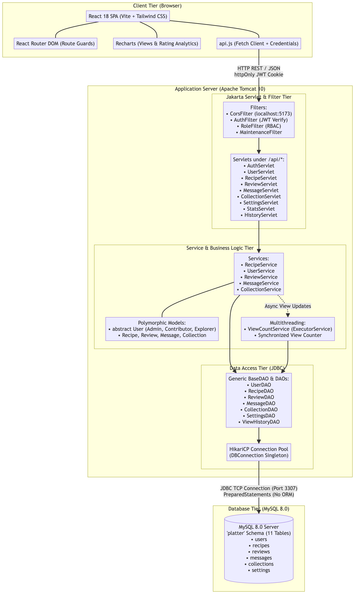

---

## 🗄️ Entity-Relationship Diagram (11 Tables)

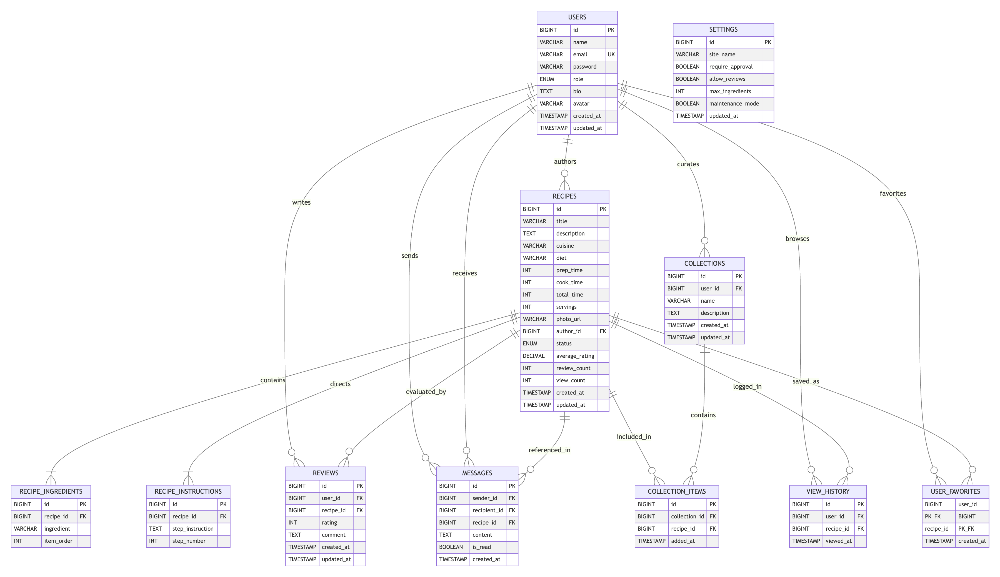

---

## 📸 Responsive UI Screenshots (Desktop 1280px vs Mobile 390px)

All core flows were verified across desktop (`1280x800`) and mobile (`390x844`) viewports:

| View / Page | Desktop View (1280px) | Mobile View (390px) | Description |
| :--- | :--- | :--- | :--- |
| **Authentication & Sign-in** | [`desktop_login.png`](docs/screenshots/desktop_login.png) | [`mobile_login.png`](docs/screenshots/mobile_login.png) | Email/password sign-in form with demo account quick-switch buttons |
| **Home & Recipe Browse** | [`desktop_browse.png`](docs/screenshots/desktop_browse.png) | [`mobile_browse.png`](docs/screenshots/mobile_browse.png) | Search bar, dietary/cuisine filter pills, sorting dropdown, and recipe cards |
| **Recipe Detail View** | [`desktop_recipe_detail.png`](docs/screenshots/desktop_recipe_detail.png) | [`mobile_recipe_detail.png`](docs/screenshots/mobile_recipe_detail.png) | Hero photo, author info, ingredient checklist, cooking steps, and review list |
| **Explorer Dashboard** | [`desktop_explorer_dashboard.png`](docs/screenshots/desktop_explorer_dashboard.png) | [`mobile_explorer_dashboard.png`](docs/screenshots/mobile_explorer_dashboard.png) | Browsing history, saved favorite recipes, and custom collection manager |
| **Contributor Dashboard** | [`desktop_contributor_dashboard.png`](docs/screenshots/desktop_contributor_dashboard.png) | [`mobile_contributor_dashboard.png`](docs/screenshots/mobile_contributor_dashboard.png) | Recipe publication table, approval statuses, Recharts view/rating charts, and messaging |
| **Admin Dashboard** | [`desktop_admin_dashboard.png`](docs/screenshots/desktop_admin_dashboard.png) | [`mobile_admin_dashboard.png`](docs/screenshots/mobile_admin_dashboard.png) | User management table, recipe approval queue, system configuration toggles, and review moderation |

### Screenshot Preview Gallery

#### 1. Home & Recipe Browsing
| Desktop (1280px) | Mobile (390px) |
| :---: | :---: |
| 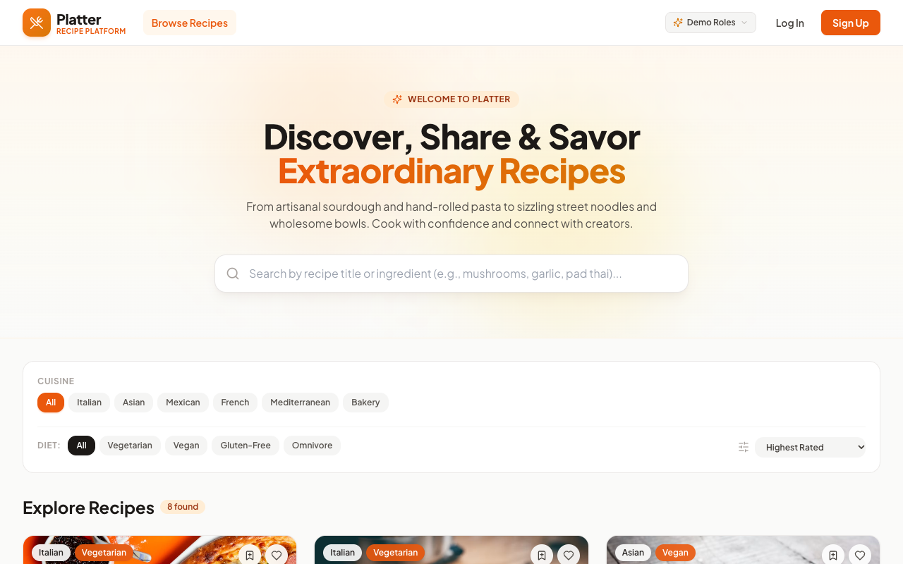 | 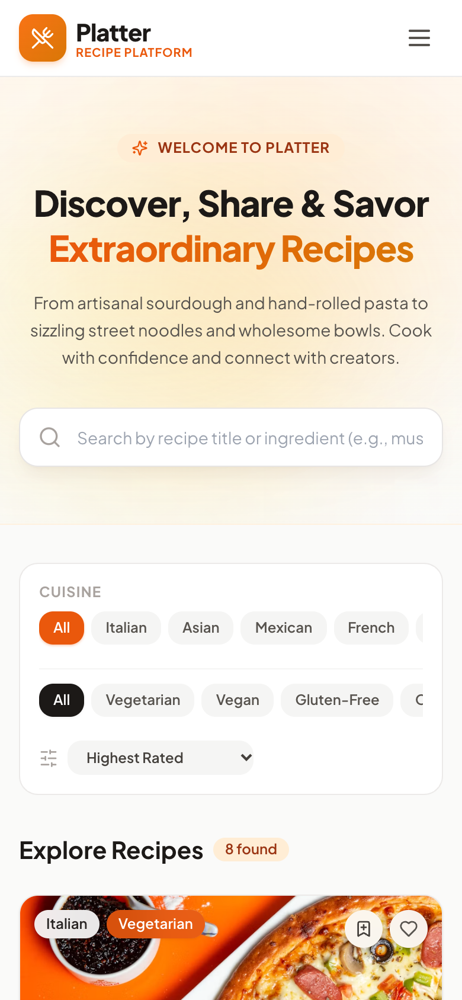 |

#### 2. Recipe Detail
| Desktop (1280px) | Mobile (390px) |
| :---: | :---: |
| 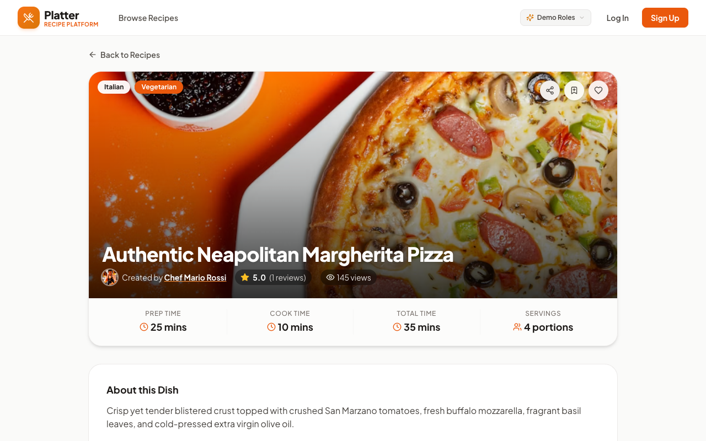 | 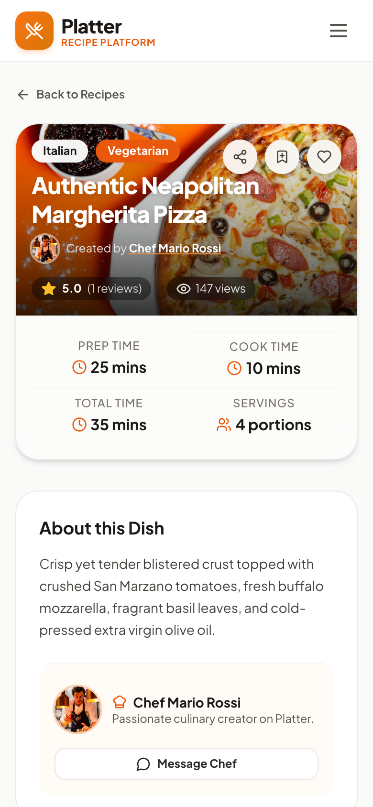 |

#### 3. Explorer Dashboard
| Desktop (1280px) | Mobile (390px) |
| :---: | :---: |
| 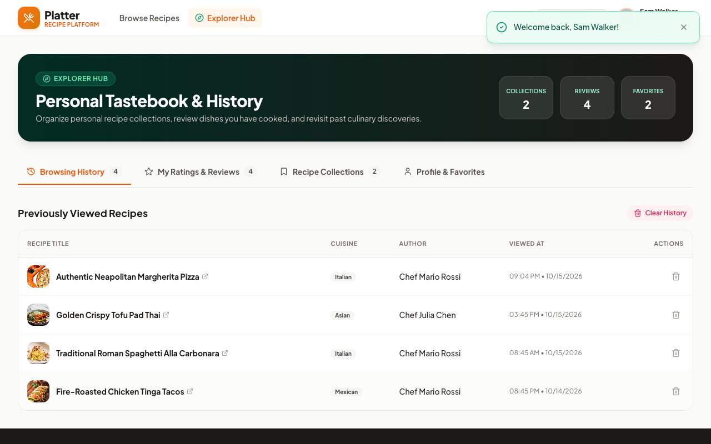 | 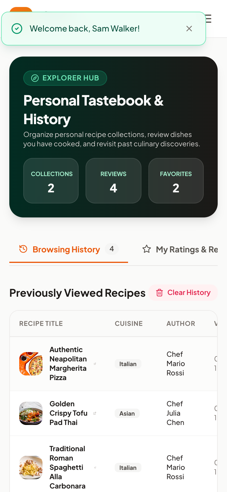 |

#### 4. Contributor Dashboard
| Desktop (1280px) | Mobile (390px) |
| :---: | :---: |
| 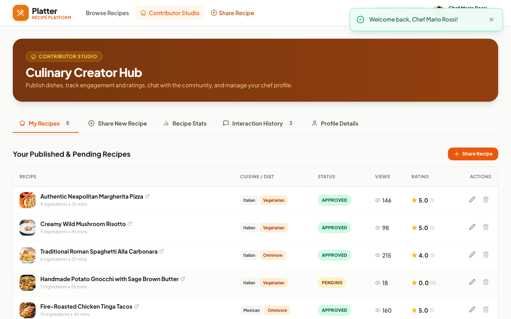 | 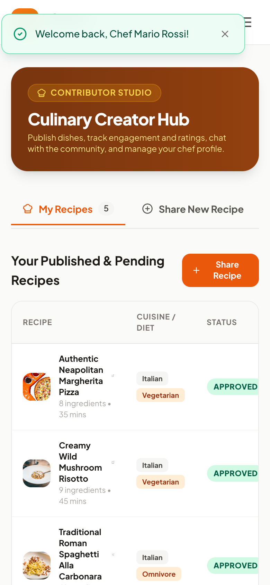 |

#### 5. Admin Dashboard
| Desktop (1280px) | Mobile (390px) |
| :---: | :---: |
| 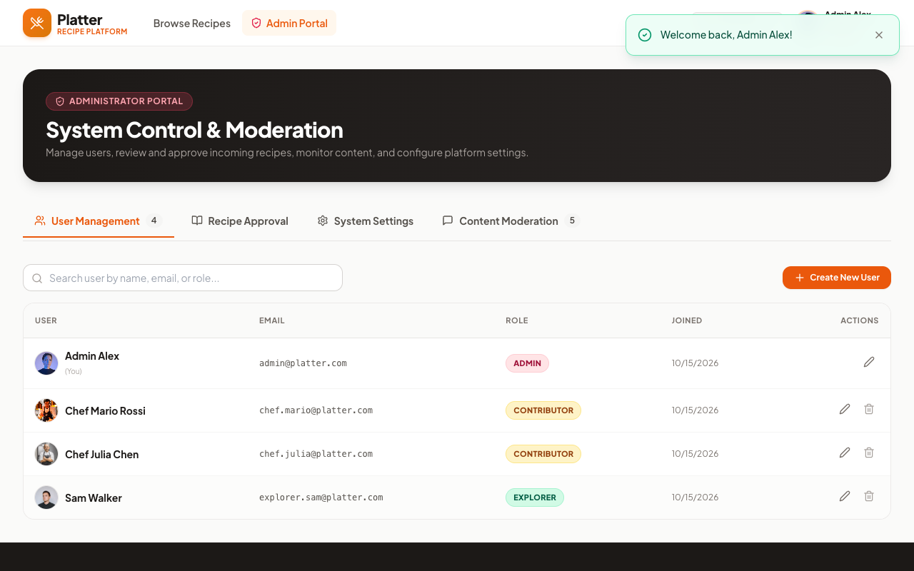 | 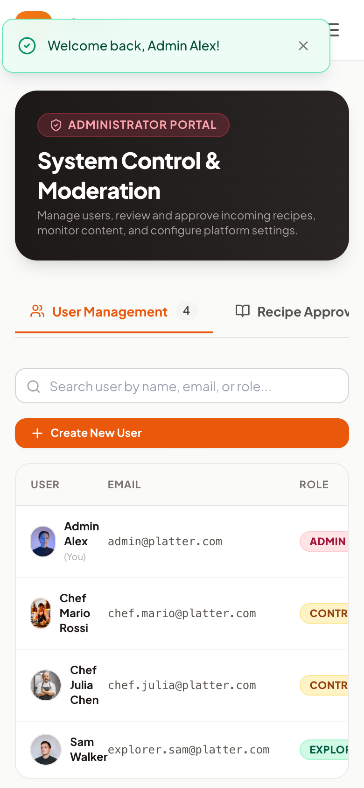 |

#### 6. Login & Quick Roles
| Desktop (1280px) | Mobile (390px) |
| :---: | :---: |
| 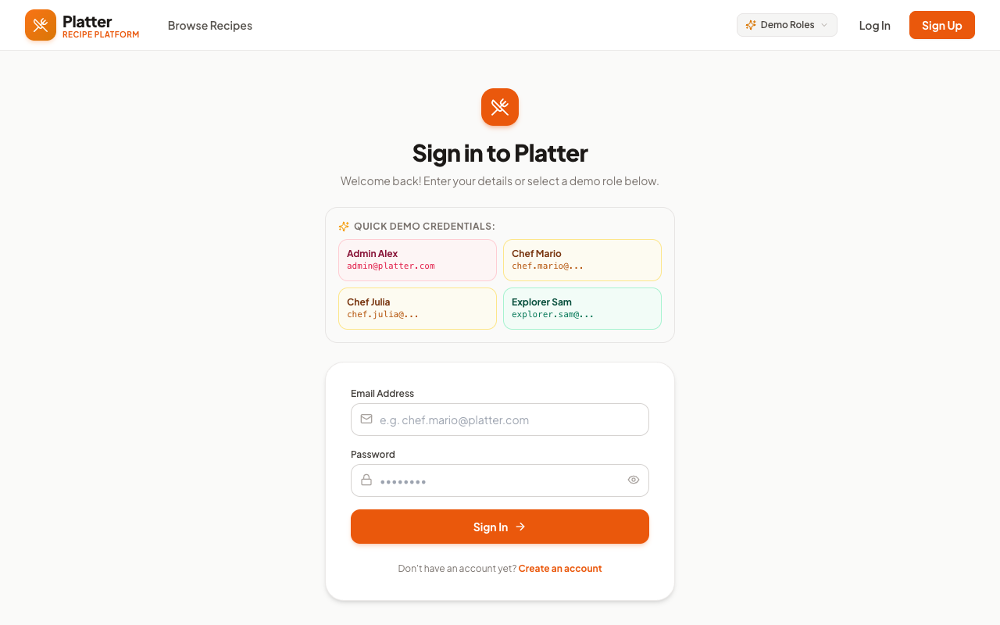 | 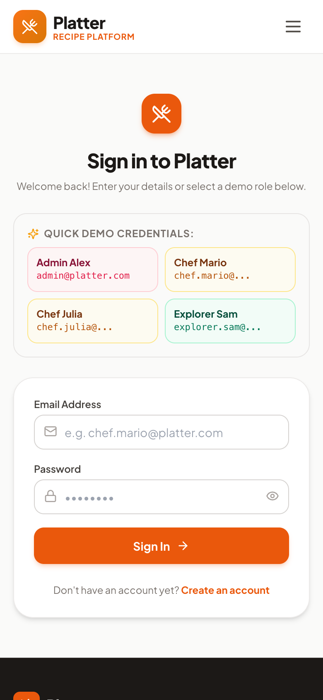 |

